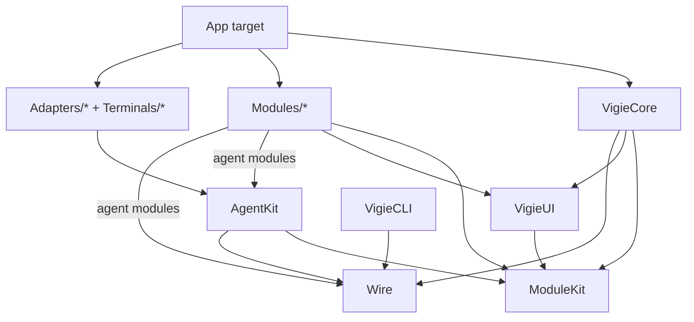
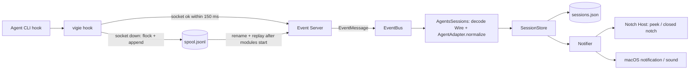
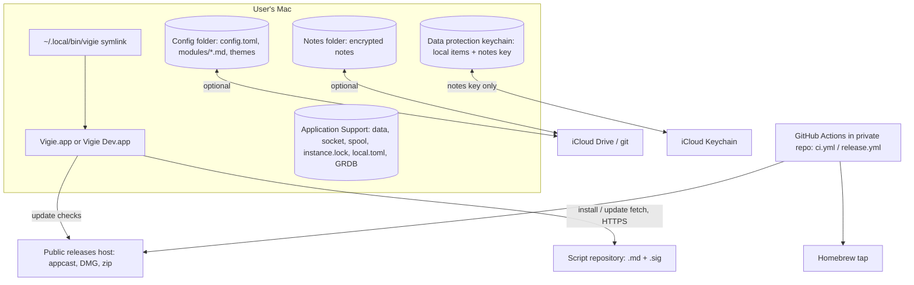

# Architecture Spine — Vigie

## Design Paradigm

**Microkernel (plug-in).** A small host (Notch Host, Module Registry, Core Services) runs independent modules that see the system only through `ModuleContext`. **Ports & adapters** at the edges: every agent CLI sits behind an `AgentAdapter`, every terminal behind a `TerminalAdapter`, every external integration behind a script module; adapters see the system only through `AdapterContext`. Module UI is SwiftUI over per-module observable state.

| Layer | Lives in | May depend on |
| --- | --- | --- |
| App assembly | `App/` (thin Xcode target) | everything below |
| Core (host + services) | `Packages/VigieCore` | ModuleKit, VigieUI, Wire |
| Modules | `Packages/Modules/*` | ModuleKit, VigieUI; agent modules also AgentKit, Wire |
| Adapters | `Packages/Adapters/*`, `Packages/Terminals/*` | AgentKit |
| Contracts | `Packages/ModuleKit`, `Packages/AgentKit`, `Packages/Wire` | ModuleKit, Wire: Foundation / SwiftUI only. AgentKit → ModuleKit, Wire |
| Shared UI | `Packages/VigieUI` | ModuleKit |
| CLI | `Packages/VigieCLI` | Wire only |



## Invariants & Rules

### AD-1 — Modules are isolated packages [ADOPTED]

- **Binds:** all modules, adapters
- **Prevents:** modules reaching into each other's types or state; hidden coupling that breaks "every module can be turned off".
- **Rule:** Each built-in module, adapter and terminal adapter is its own SwiftPM target. A module depends only on ModuleKit, VigieUI and (agent modules only) AgentKit and Wire — never on another module or on VigieCore. Cross-module interaction goes only through `ModuleContext` services (AD-19). The dependency graph above is enforced by `Package.swift`.

### AD-2 — SwiftPM-first, thin app target [ADOPTED]

- **Binds:** all code
- **Prevents:** hand-edited `.pbxproj` conflicts; code that can't be tested with `swift test`.
- **Rule:** All code lives in local Swift packages under `Packages/`. The Xcode project contains only the app target (entitlements, Info.plist, assets, assembly code, bundling the CLI). New code never goes in the app target unless it is assembly or bundle configuration.

### AD-3 — Swift 6 strict concurrency; main-actor UI state [ADOPTED]

- **Binds:** all Swift targets
- **Prevents:** data races; UI updated from background threads; mixed state patterns across modules.
- **Rule:** Swift 6 language mode, complete concurrency checking, in every target. Each module owns its state as `@MainActor @Observable` models read directly by SwiftUI. I/O (socket, file scans, log parsing, scripts, network, disk persistence) runs in actors or tasks off the main actor and publishes results back to the main actor. Types crossing module, adapter or host boundaries are `Sendable`. No global mutable singletons; no central app store; no TCA.

### AD-4 — App assembly is the only composition point [ADOPTED]

- **Binds:** App target, Module Registry, agent modules, adapters, onboarding
- **Prevents:** modules discovering adapters or each other on their own; two different adapter lists in sessions and usage.
- **Rule:** The app target builds the list of modules, agent adapters and terminal adapters, builds each adapter's `AdapterContext` from VigieCore services, and hands them to the Module Registry and to `agents.sessions` / `agents.usage` through their initializers. Both agent modules receive the same adapter instances. Adding an adapter = new package + one line in assembly; no change to either agent module. Onboarding steps that need adapters are composed in App assembly; modules contribute onboarding steps through ModuleKit.

### AD-5 — Single session status authority [ADOPTED]

- **Binds:** agents.sessions, agent adapters, `vigie agent`, Event Server
- **Prevents:** adapters or CLIs setting statuses inconsistently; statuses that skip the transition table; out-of-order or stale events corrupting state; sessions dropped by a wrong PID or by a sleep/liveness race.
- **Rule:** Adapters only translate native events into the normalized events of SPEC §7.1 (`AgentAdapter.normalize`). One `SessionStore` in `agents.sessions` applies the SPEC §7.1 transition table (incl. done → idle after `done_to_idle`, host-slept → failed) and is the only code that writes a session status. Session identity = `<adapter id>:<native session id>`.
  - **Time and order:** all timing (T+, `done_to_idle`, `stale_after`) uses the envelope's `sent_at` (AD-7), never arrival time. An event whose `sent_at` is earlier than the last event applied to that session does not change status (it may still update metadata such as last action). Replayed events update state, but a replayed transition with `sent_at` older than 5 min posts no Notifier event.
  - **Agent PID:** the CLI sends its ancestor chain (`[{pid, ppid, name, start_time}]`, up to 8 levels) and never picks the agent PID itself. `AgentAdapter.agentProcess(in:)` picks it; the generic path uses the first ancestor that is not a shell. Liveness compares PID and process start time.
  - **Sleep/wake:** on a wake event from `context.power`, `SessionStore` first marks every session that was working at sleep time `failed (host_slept)` with T+ from wake, and only then resumes liveness. Liveness never removes a `failed` session; a failed session whose process has ended stays listed until the user dismisses it or 24 h after entering `failed`, whichever comes first. Idle-sleep prevention is requested only by `agents.sessions` through `context.power` while any session is working; the power service honours `[general] prevent_idle_sleep`.
  - **Generic agents:** `vigie agent` sends topic `agent.generic` with the raw flags; the mapping lives only in `agents.sessions`: `working → prompt.submit`, `blocked → needs.input`, `done → turn.end`, `failed → session.error`, `idle → session.start` (re-entry allowed for generic sessions), `--end → session.end`. Generic identity = `generic.<agent>:<session>`; an `--agent` equal to a registered adapter id is dropped by the CLI (exit 0, log line).
  - **Persistence:** the session table is persisted on status or membership change only (not heartbeats), atomically, off the main actor.

### AD-6 — Durable event path: socket, else spool; fixed launch order [ADOPTED]

- **Binds:** VigieCLI, Event Server, SessionStore, Module Registry
- **Prevents:** lost hook events and stale statuses when the app is quitting, crashed or relaunching after an update; replay into no subscribers; the replay/truncate race; a CLI slowing the agent down.
- **Rule:** For `hook`, `agent`, `event` and `reload`, the CLI sends one JSON line to the socket with a non-blocking connect and write and a 150 ms total budget; on failure or timeout it appends the same line to `spool.jsonl`, opened `O_APPEND`, under `flock(LOCK_EX)`, in a single `write`. It completes synchronously (never forks, detaches or retries in the background) and exits 0 with no output in every case. Payloads over 1 MiB are replaced by `{"truncated": true}` plus the adapter's identifying fields.
  - **Launch order:** (1) take the instance lock (AD-21); (2) the Event Server binds the socket and queues incoming lines without dispatching; (3) the Registry starts enabled modules (`SessionStore` loads `sessions.json` and subscribes); (4) a leftover `spool.replaying.jsonl` is replayed first, then `spool.jsonl` is atomically renamed to `spool.replaying.jsonl`, dispatched in file order with `replayed = true`, and deleted; (5) queued socket lines are dispatched; (6) the host posts `host.ready` and `SessionStore` runs one liveness reconcile.
  - CLI writers only ever append to `spool.jsonl`, so lines written after the rename survive. While running, the Event Server drains the spool the same way whenever `spool.jsonl` appears.
  - **`vigie run` carve-out:** `vigie run -- <cmd>` runs the command as a child with inherited stdio, forwards signals, and exits with the child's exit code; the child's output and exit code pass through unchanged. Only its event sends (`working` at start, then `done` / `failed` by exit code) follow the socket-else-spool rule above, each within the 150 ms budget; the command runs whether or not the app is running. It reports through topic `agent.generic` with agent `run` (AD-5); a user interrupt (SIGINT) sends `--end` instead, so no Notifier event is posted.

### AD-7 — Versioned wire format [ADOPTED]

- **Binds:** Wire, VigieCLI, Event Server, spool, EventBus
- **Prevents:** a CLI or spooled event from another app version breaking or silently corrupting the app; core code interpreting agent payloads; untyped event payloads.
- **Rule:** Every socket message and spool line is `{ "v": <int>, "topic": "...", "sent_at": "<ISO 8601 UTC>", "payload": {...} }`, with `sent_at` set by the CLI at capture. The app accepts version `v` and `v-1`, ignores unknown fields, and drops (with a log entry) anything else. Wire types live only in the `Wire` package; the CLI and the core never define their own copies. The Event Server only decodes the envelope and publishes `EventMessage { topic, payload: Data, sentAt, receivedAt, replayed }` (declared in ModuleKit) on `context.events`; it never interprets payloads. Agent modules decode `agent.*` payloads with Wire types and call `normalize` themselves.

### AD-8 — ConfigStore is the only config writer [ADOPTED]

- **Binds:** VigieCore, Settings window, all modules, sync
- **Prevents:** two writers clobbering `config.toml`; user comments and ordering lost; modules writing files directly; per-Mac keys leaking into the synced file; writes on a stale copy; an older Mac freezing on a newer config.
- **Rule:** `ConfigStore` is the only code that reads or writes `config.toml` and `local.toml`. Modules read and write through `context.settings`; the Settings window writes through it.
  - **Reading:** swift-toml decodes only; it never writes. A file is invalid only on a TOML parse error (setup-problem alert, last valid config stays active). Unknown keys and tables are ignored on read (logged once). A known key with a wrong type or out-of-range value falls back to its default and raises a setup-problem alert naming the key; the rest of the file applies.
  - **Writing:** ConfigStore's own line-level TOML patcher (named work, with a round-trip test corpus: comments, inline tables, arrays of tables) replaces or inserts single `key = value` lines in the target table and leaves every other line byte-identical. Every write re-reads the file, patches the fresh text, re-parses the result, aborts if the parse fails or the decoded value differs from the intended one, then writes atomically (temp + rename) to the symlink-resolved path. Unknown keys and tables are preserved byte-for-byte.
  - **Synced vs local:** every `SettingDescriptor` declares `scope: .synced | .local`; ConfigStore routes reads and writes by that declaration, never by a hard-coded list. Sections SPEC §11 marks *local*, folder locations, `[sync]`, and per-Mac script state (`enabled`, confirmed hash) are `.local`. `local.toml` lives in Application Support (AD-17), never in the config folder. For a key present in both files, local wins.
  - **Watching:** the watcher observes the containing directory (AD-12) and ignores events whose content hash equals ConfigStore's last write. Observers are notified only for keys whose resolved value changed.

### AD-9 — Secrets only through SecretStore [ADOPTED]

- **Binds:** VigieCore, notes, agent usage providers, script modules, App target signing, release
- **Prevents:** secrets in config, logs, JSON state or synced folders; inconsistent sync flags; keychain calls failing in signed builds (`errSecMissingEntitlement`).
- **Rule:** All Keychain access goes through the core `SecretStore`, reached by modules as `context.secrets` and by adapters as `AdapterContext.secrets`, both scoped by owner id. Only the main app process touches the Keychain; the `vigie` CLI never does. All items use the data protection keychain (`kSecUseDataProtectionKeychain = true`) in access group `<TeamID>.<bundle id>`, except the notes key, which lives in `<TeamID>.<release bundle id>.notes`, shared by Vigie and Vigie Dev. Items are local-only (non-synchronizable) except the single notes encryption key, which is a synchronizable iCloud Keychain item with a user-exportable recovery key; if iCloud Keychain is off, the key stays local and the recovery key is the only cross-Mac route. The app carries `keychain-access-groups` under an embedded Developer ID provisioning profile (AD-20). Secrets never appear in config files, app data files, logs or diagnostics. Script settings of type `secret` are injected as environment variables at run time only. **External credentials** (amended 2026-11-06): SecretStore may read a credential owned by another app (e.g. Claude Code's stored login, for opt-in plan limits) only through `readExternal(_ descriptor:)`, only while a per-Mac, per-Account user consent recorded in `local.toml` is present (never synced, revocable), and only into memory for the request that needs it; it never copies, caches, writes, renews or deletes the external item. The descriptor is declared by the adapter and shown in the consent text.

### AD-10 — Notes are encrypted one file per note [ADOPTED]

- **Binds:** notes
- **Prevents:** plaintext notes in iCloud Drive; whole-store conflicts; note text lost when two Macs edit the same note; two Macs or builds minting different keys for one notes folder.
- **Rule:** Each note is one file in the notes folder, encrypted with the notes key (CryptoKit authenticated encryption), starting with a plaintext header `{format, key_id}`. Plaintext exists only in memory. Sync is whatever iCloud Drive does with the folder. **Conflicts** (amended 2026-11-07, user ruling): no note text is ever lost; when a note file has unresolved conflict versions (`NSFileVersion`, read through `NSFileCoordinator` per AD-12), the notes module keeps the current version in the note's file and saves each other version as a new note file titled `<title> (conflict)`, encrypted with the same key, and only then marks the conflict versions resolved. The notes module never creates a key while the notes folder contains note files; if files carry a `key_id` it does not hold, it shows a waiting / enter-recovery-key state and writes nothing. If Vigie Dev cannot read the release notes key, it uses its own notes folder. The notes key is created only on an explicit user action ("Set up notes"); if a notes key may already exist in iCloud Keychain or the folder holds notes, setup waits for it to sync or asks for the recovery key, never creates a second key.

### AD-11 — Data ownership and storage [ADOPTED]

- **Binds:** all modules, VigieCore
- **Prevents:** modules reading each other's files; ad-hoc storage engines.
- **Rule:** Each module stores data only through `context.storage`, which maps to `Application Support/<app folder>/modules/<module id>/`. Small state is JSON (Codable). Usage history is the only SQLite database (GRDB), owned by `agents.usage`, filled by incremental ingest of agent logs through `AgentAdapter.logReader` (AD-23). No SwiftData, no Core Data. Nothing in Application Support is synced. Exceptions: `notes` writes its notes folder through `context.storage.userFolder(setting:)`; `shelf` moves expired copies to the Trash with `NSWorkspace.recycle`.

### AD-12 — Sync is folder placement [ADOPTED]

- **Binds:** config, notes, scripts, themes
- **Prevents:** a second sync mechanism or server dependency; main-thread stalls on not-yet-downloaded files; watchers losing atomically replaced files.
- **Rule:** Sync = the config folder and/or notes folder sit in iCloud Drive (or git). Vigie adds no CloudKit or custom sync. Code tolerates files changing underneath it (watch, reload, last writer wins; note files are the exception, their conflicts keep both versions per AD-10). Reads of synced folders run off the main actor through `NSFileCoordinator`, after checking `ubiquitousItemDownloadingStatus`; a file that is not current gets `startDownloadingUbiquitousItem` and is treated as pending (last good value kept). Watchers observe the containing directory (or use `NSFilePresenter`), never a single file's inode. Only ConfigStore relocates the config and notes folders and records their locations in `local.toml`; turning `[sync] icloud` on moves the config and notes folders into `iCloud Drive/Vigie/`; turning it off moves them back to their local defaults.

### AD-13 — All alerts go through Notifier; the host owns the notch and focus [ADOPTED]

- **Binds:** all modules, Notch Host, Notifier, HotkeyRegistry
- **Prevents:** modules posting macOS notifications, sounds or peeks directly; competing peeks; alert settings with several owners; reminders for resolved conditions; untyped actions; focus stolen without user intent; hotkey collisions.
- **Rule:** Modules post events to `Notifier`, which applies rules (mute, severity, cooldown, reminder, Do Not Disturb) and outputs (peek, system, sound). Only the Notch Host shows peeks and arbitrates the closed notch (SPEC §5). No module creates windows or panels except the notes floating panel, which is requested through `context.host`.
  - **Alert config:** Notifier is the only reader of `[modules."<id>".notify."<kind>"]` and `[sounds]` (sound keys map to kinds by one table in Notifier). Modules declare their kinds in the manifest and never declare alert or sound settings themselves; the alert settings UI is generated from declared kinds. Canonical kinds: `session.blocked`, `session.done`, `session.failed`, `usage.quota_warning`, `shelf.expiring`, `time.timer_end` (Timer or Countdown end, or a Pomodoro break end), `time.break_reminder` (a break reminder, or a Pomodoro work-phase end: the break waits for Start break; amended 2026-11-07, user ruling), `calendar.reminder` (an event's own EventKit alarm time; Calendar has no closed-notch item, amended 2026-11-07), `setup.problem`. Sound-capable kinds: the three `session.*` kinds, `usage.quota_warning`, the two `time.*` kinds and `calendar.reminder`; Notifier's sound table maps `time.timer_end` → `[sounds] timer_end`, `time.break_reminder` → `[sounds] break_reminder` and `calendar.reminder` → `[sounds] calendar_reminder` (off by default).
  - **Privacy:** every output passes the Privacy filter (AD-24); macOS notification text is redacted the same way as peeks.
  - **Lifecycle:** `post` returns an `AlertHandle`; the module calls `resolve()` when the condition ends, which cancels pending reminders and retracts a visible peek. `action` is `.module(id:, actionID:, payload: Data)` routed back to the posting module, `.openSettings(pane:)` or `.openURL`.
  - **Focus:** focus-taking host calls (`expand(focus:)`, `showPanel(focus:)`) require a `UserIntent` token that VigieCore issues only inside hotkey callbacks, clicks and menu actions; without it surfaces open without focus. At most one Vigie surface is key at a time; Esc closes only the key surface.
  - **Hotkeys:** names are namespaced `<module id>.<name>`; on a conflict the earlier registration wins and the later module raises a setup-problem alert. Peek shortcuts take precedence over every other Vigie shortcut while a peek is visible.

### AD-14 — Themes are TOML token files [ADOPTED]

- **Binds:** VigieUI, all module views, themes
- **Prevents:** hard-coded colors, sizes or durations in views; built-in and custom themes drifting apart; inconsistent override precedence.
- **Rule:** Every theme, built-ins included, is a TOML file of the DESIGN.md tokens carrying `schema = <int>`. Built-in theme files are generated from DESIGN.md frontmatter by an executable target in the VigieUI package that uses the same Codable token types as the loader; CI regenerates them and fails on any diff; `Themes/` is never hand-edited. Custom themes live in the config folder, extend the shared base, and must not reuse a built-in id (a clash is ignored with a setup-problem alert); a newer `schema` falls back to the base theme with a setup-problem alert. Views read colors, metrics, motion and glyphs only from the active theme via VigieUI. Resolution order, last wins: shared base → skin → look (light/dark) → custom theme file → `[appearance.colors]` (all looks) → `[appearance.colors.<light|dark>]` → accessibility adjustments (may raise contrast, never discard a user override's hue). The physical notch always resolves the dark look. Presence level and macOS accessibility settings are resolved once in VigieUI, not per module.

### AD-15 — Localized strings only [ADOPTED]

- **Binds:** all targets with user-facing text
- **Prevents:** hard-coded English shipping in views; inconsistent copy; package strings silently missing at run time.
- **Rule:** Every user-facing string comes from a String Catalog in its package, looked up with `bundle: .module` (`String(localized:bundle:)`, `Text(_:bundle:)`). Copy follows EXPERIENCE.md Voice and Tone; status labels are defined once in VigieUI and exposed as public API, not as generated catalog symbols. Info.plist usage strings come from an InfoPlist catalog in the app target. CI builds and tests through `xcodebuild` so catalogs compile, and checks the built bundle contains every shipped locale.

### AD-16 — Dependency allowlist, no telemetry [ADOPTED]

- **Binds:** all `Package.swift` files
- **Prevents:** dependency sprawl; data leaving the machine.
- **Rule:** Third-party dependencies are limited to the Stack table. Adding one requires a new AD (front matter: Yams; note Markdown: swift-markdown; script output is validated by Swift `Codable` types, with a CI check that they match `schemas/script-module.schema.json`, no JSON Schema library). No analytics, no automatic crash reporting, no network calls except: Sparkle update checks, opt-in plan-limit usage providers (through `AdapterContext.http` only), script modules, and script install and update fetches (user-initiated from a `vigie://install` link, or user-enabled update checks; HTTPS only, through the integrations module, AD-18). Diagnostics are collected only by the user-triggered "Copy diagnostics" action, with secrets excluded.

### AD-17 — Dev build isolation [ADOPTED]

- **Binds:** App target, VigieCore, VigieCLI, CI
- **Prevents:** a dev build reading or corrupting the installed build's sessions, socket, spool or config; the CLI hard-coding paths; socket bind failures on long paths.
- **Rule:** Debug/dev builds use a distinct bundle ID (`fr.baguettelabs.vigie.dev`, display name "Vigie Dev"; release `fr.baguettelabs.vigie`), their own Application Support folder (socket, spool, `local.toml`, data), CLI name `vigie-dev`, and hook installers that write `vigie-dev hook …`. The config folder defaults to the release one but can be overridden for dev. All paths derive from one `AppEnvironment` value (bundle id, CLI name, Application Support, socket, spool, lock, `local.toml`, config default), declared in `Wire` and selected by a compile-time flag shared by the app and CLI targets, never from literals. The socket path must be ≤ 100 bytes; if longer, both sides use `<DARWIN_USER_TEMP_DIR>/<bundle id>/vigie.sock` (from `confstr`, not `$TMPDIR`). Dev builds are signed with a stable Apple Development identity and a dev provisioning profile, never ad-hoc.

### AD-18 — Script modules run through one runner [ADOPTED]

- **Binds:** integrations, VigieCore, Module Registry, sync, App target (URL scheme)
- **Prevents:** scripts executed before confirmation on this Mac; inconsistent env/timeout handling; script ids hijacking built-in modules or host keys; scripts without a module identity; link installs or updates that skip confirmation; unverifiable "official" scripts.
- **Rule:** Only the integrations runner executes script code blocks, with the declared `runtime` resolved through `context.executables`, settings as `VIGIE_SETTING_*`, timeout `min(interval, 30s)` (on timeout the process group is killed), and output validated against `schemas/script-module.schema.json`. A script runs only if its current content hash is confirmed on this Mac; confirmations are keyed by file path relative to the config folder plus SHA-256 of the file bytes and stored in `local.toml`; any content change requires re-confirmation. Integrations registers one `NotchModule` per confirmed script via `context.host.registerDynamicModule(manifest:)` and unregisters it on removal or decline (`NotchModule.manifest` is an instance property). Script ids must not equal a built-in id or start with `agents.`; a duplicate or reserved id puts every file declaring it in an errored state with a setup-problem alert. Script settings must not use host-owned keys (`enabled`, `side`, `priority`, `surfaces`, `notify`). Script widgets are rendered only by VigieUI templates.
  - **Install from link:** the app target registers the `vigie` URL scheme; the handler routes `vigie://install?url=<https URL>[&sig=<url>]` to integrations only, which fetches over HTTPS (any other scheme is refused), parses front matter, and shows the full file, source URL and author before confirmation. Nothing is written to the scripts folder until confirmed; a declined install leaves no file. A confirmed install writes the file with its source metadata and records its confirmation as above.
  - **Updates:** integrations re-fetches each recorded source at most once a day (user can turn it off); if the bytes differ it shows a diff and asks for a new confirmation. The old file and its confirmed hash keep running until the new version is confirmed; only then is the file replaced atomically.
  - **Signatures:** on install and every update, integrations verifies a detached Ed25519 signature (`<script>.md.sig`, or the link's `sig`) over the exact file bytes with CryptoKit against the list of public keys compiled into the app (rotated only by an app update). Signatures are produced only by the Script repository CI from a protected environment. Valid → "Verified: Vigie Script repository"; missing or invalid → stronger warning, author shown as claimed by the file. A signature never replaces confirmation.

### AD-19 — ModuleContext and AdapterContext are the complete service API [ADOPTED]

- **Binds:** ModuleKit, AgentKit, VigieCore, App assembly, all modules and adapters
- **Prevents:** each module or adapter inventing its own Keychain, power, clipboard, permission, drop-zone or process path; two owners of one system facility.
- **Rule:** `ModuleContext` (declared in ModuleKit, implemented only in VigieCore) exposes exactly: `settings`, `storage`, `secrets`, `scheduler`, `hotkeys`, `notifier`, `events`, `host` (peek, expand, panels, focus requests with `UserIntent`, dynamic modules), `permissions`, `power` (`preventIdleSleep(reason:) -> Token`, `sleepWake: AsyncStream<SleepWakeEvent>`), `clipboard` (`copy(_:clearAfter:)`), `executables` (login-shell PATH captured once per launch with a 2 s timeout, plus per-runtime overrides in `local.toml`), `privacy` (AD-24), `away` (AD-25), `activity` (AD-26), and `log`. `AdapterContext` (declared in AgentKit, built by App assembly) exposes `settings` (read-only adapter settings), `secrets`, `executables`, `http`, `log`. A missing facility is added to the contract and VigieCore first; modules and adapters never call Security, IOKit power, `NSWorkspace` sleep/wake, `NSPasteboard` writes, TCC request APIs, or `Process` with a bare executable name.
  - **Drop zones:** declared on the module (`NotchModule.dropZones`) and collected by the host; no other registration path. `DropZone` is `Sendable`: `{ id, label: LocalizedStringResource, glyph, accentToken, role: .primary | .secondary, cell: DropCell, order: Int, accepts, handler: @Sendable (DropPayload) async -> DropResult }`, where `DropCell { preferredColumn, preferredRow, span: (columns, rows) }` places the zone in the host's drag-only **drop display** (a 4 × 2 grid attached to the notch, shown only while a file is dragged over it; UX Story 1.7c layout B: Stash primary 2 × 2, Ask AI 1 × 2, AirDrop and Image to Text 1 × 1), and `DropPayload { urls, modifiers: EventModifiers, source: .dropDisplay | .shelfTab | .homeWidget | .stashItem | .paste | .service }`. The host lays out the drop display itself: it places zones by `role` (exactly one primary), preferred cell and `order`, hides zones whose module or setting is off and reflows the grid so a neighbour takes the freed cells; modules never position views in it. Shelf renders the same zones on its tab (`SEND TO` card) and Home widget; Shelf disabled ⇒ Stash, AirDrop and Image to Text disappear (they are Shelf zones) and Ask AI stays in the drop display while `agents.sessions` is on; with no enabled zone, no drop display appears. **Non-drag paths** (amended 2026-11-07, accessibility): the Shelf's `Send to` menu and VoiceOver actions on a stash item call a zone handler with source `.stashItem`; `⌘V` on the Shelf tab calls the Stash handler with the clipboard contents, source `.paste` (clipboard reads go through the host); the macOS Services entry `Stash in Vigie` (AD-20) is received by the host and routed to the Stash handler, source `.service`. All three need the Shelf on. (Amended 2026-11-07: replaces `placement: .leading | .trailing` and `source: .closedNotch` from the two-wing closed-notch zones.) The host materializes file promises into `<Application Support>/drops/` before calling a handler. Shelf starts security-scoped access before calling a handler and ends it after the handler returns; handlers finish reading files before returning.

### AD-20 — Runtime envelope: signing, entitlements, TCC [ADOPTED]

- **Binds:** App target, VigieCLI, VigieCore Permissions, Terminals/*, release
- **Prevents:** features that work in debug and fail silently in the hardened, notarized build; missing usage strings; entitlement sprawl; permissions requested for features that are off; updates that depend on a public source repository.
- **Rule:** Vigie.app is unsandboxed, Hardened Runtime on, Developer ID signed with an embedded Developer ID provisioning profile (explicit App ID, Keychain Sharing), notarized. Allowed entitlements: `com.apple.security.automation.apple-events`, `keychain-access-groups` (plus the application and team identifiers the profile requires); nothing else without a new AD. The bundled CLI is signed with Hardened Runtime and no entitlements. Info.plist carries `LSUIElement = YES`, `NSAppleEventsUsageDescription`, `NSCalendarsFullAccessUsageDescription`, `CFBundleURLTypes` for the `vigie` scheme (`vigie-dev` in dev builds, AD-17), and `NSServices` with one entry, `Stash in Vigie` (file URLs and plain text), handled by the app target's services provider and routed to drop zones (AD-19; amended 2026-11-07). No Share extension or other app extension target in v1. `Permission` has cases `.accessibility`, `.automation(bundleID)`, `.calendar`, `.notifications`, `.screenRecording`; folder access is on-demand TCC. `.screenRecording` is requested only if the Privacy mode detection method chosen by its spike needs it, and only while automatic detection is turned on (AD-24). The provisioning profiles (release and `.dev`) are stored as `release`-environment secrets and installed by `release.yml`.
  - **Release hosting:** the code repository is private. Signed DMGs, update zips and the Sparkle appcast are published to a public location (a public releases-only GitHub repository or a static host); `SUFeedURL` and the Homebrew cask point only there. `release.yml` in the private repo publishes to it; no source is published.

### AD-21 — Process model and single instance [ADOPTED]

- **Binds:** App target, VigieCore host and Event Server, Settings window, Sparkle
- **Prevents:** two instances fighting over the socket; a terminating instance deleting the new one's socket after a Sparkle relaunch; helper processes creeping in.
- **Rule:** One GUI process (accessory activation policy) plus short-lived `vigie` CLI processes and script child processes. No XPC services, LaunchAgents or helpers; launch at login only through `SMAppService.mainApp` (onboarding asks, preselected on). Never a Dock icon, including while Settings is open. Single instance per `AppEnvironment`: at launch the app takes an exclusive `flock` on `<Application Support>/instance.lock` before touching socket or spool; if the lock is held, it sends `app.expand` to the running instance over the socket and quits. A stale socket file is unlinked only while holding the lock; on exit the app unlinks the socket path only if its inode is still the one it bound.

### AD-22 — One installer for the CLI and agent config edits [ADOPTED]

- **Binds:** VigieCore (`CLIInstaller`, `IntegrationInstaller`), adapters, onboarding, Homebrew cask
- **Prevents:** hooks that exit 127 because `vigie` is not on PATH; three adapters with three ways to edit agent config; dev and release builds deleting each other's hooks or the user's other hooks; clobbering concurrent edits.
- **Rule:** `CLIInstaller` ensures the symlink `~/.local/bin/<AppEnvironment.cliName>` → the bundled CLI at every launch, repairing it if the app moved. Hook commands always use that absolute symlink path, never a bare name. The Homebrew cask's `binary` stanza is for interactive shells only. Adapters only produce `ConfigDiff`s (declared in ModuleKit) and never write files. `IntegrationInstaller` alone shows the diff, re-reads the target and checks its hash matches the diff's base (else recomputes and shows the new diff), writes a timestamped backup next to the target, applies the change atomically (temp + rename), and records the result in `local.toml`. A managed hook entry is identified only by its exact command `<symlink path> hook <adapter id>`; plans add or remove only such entries, never reorder, replace or remove any other entry, including the other build's. Exception (amended 2026-11-06): when an agent allows a single program (Codex `notify`) and another program already holds it, the plan may, only on the user's explicit choice, move that program into a Vigie wrapper (`<symlink path> hook <adapter id> --chain <original argv>`) that runs the original first, then reports; the original argv is recorded in `local.toml` and Disconnect restores it exactly.

### AD-23 — Adapter contracts [ADOPTED]

- **Binds:** AgentKit, Adapters/*, Terminals/*, agents.sessions, agents.usage, Settings › Agents
- **Prevents:** adapters guessing on unsupported CLI versions; two parsers of one log format; sessions and usage disagreeing on enabled adapters or ring count; usage of two Accounts merged or their credentials shared; terminal-specific code outside terminal adapters; Automation prompts fired by background events.
- **Rule:** `AgentAdapter`, `TerminalAdapter` and `UsageProvider` are `Sendable`; any mutable state is actor-isolated.
  - **Versions:** each adapter detects the installed CLI version at start; outside its fixture-tested range it emits no normalized events and reports `unsupported(version)`, which `agents.sessions` raises as a setup-problem alert.
  - **Logs:** an adapter parses its log format in one place (`AgentAdapter.logReader`), shared by both agent modules.
  - **Settings:** adapter settings stay at SPEC §11 paths (`[modules."agents.sessions"] adapters` for the enabled list, `[modules."agents.sessions".adapter.<id>]` for each adapter's table — singular `adapter`, because TOML forbids one key being both an array and a table; amended 2026-11-08, Romain's ruling), are edited only on Settings › Agents, and are readable by `agents.usage` through a read-only `context.settings.agents` view. Disabling an adapter removes it from both modules.
  - **Usage identity:** usage is keyed by adapter id + Account. One usage provider per adapter (`id` = adapter id) serves all its Accounts, merging that adapter's sources per Account (`local` for tokens/cost, `plan` for windows/%), never splitting by source. Each Account is bound to its own agent config or log location; `logReader` and `SessionStore` attribute a session to an Account by that location. The closed-notch ring for a provider shows the Account of its most recent session; the Usage tab shows every Account. `order` keys on adapter id; per-Account settings (incl. opt-in remote limits) key on adapter id + Account and live in the adapter's table (`[modules."agents.sessions".adapter.<id>] accounts` + `account.<id>.*`, `local.toml`), never under `agents.usage` (amended 2026-11-08, Romain's ruling). Keychain items are per Account: owner `adapter.<id>`, one key per Account (e.g. `plan_token.<account>`; amended 2026-11-08).
  - **Terminals:** `TerminalAdapter` exposes `matches(env:)`, `capture(env:pid:tty:) -> TerminalLocator` (pure: no Apple Events, no AX, no I/O beyond the process table), `focus(_:)` and `openTab(argv:cwd:)`. Each session's terminal adapter is chosen by `matches` on its captured env; the `terminal` key is used only for `openTab` and as a fallback. Shell quoting of `argv` is the terminal adapter's job. Apple Events and AX calls happen only in `focus` / `openTab`, called only from a user action.

### AD-24 — Privacy mode is a host-level display filter [ADOPTED]

- **Binds:** VigieCore (Notch Host, Notifier, `PrivacyService`), VigieUI, all modules, Permissions
- **Prevents:** a module or surface leaking names or text while the screen is shared; each module inventing its own detection or redaction; macOS notifications bypassing the filter.
- **Rule:** One core `PrivacyService` owns the Privacy state (`context.privacy`: read-only `isActive` + change stream) from automatic detection (method chosen by its spike; manual toggle where detection is impossible) or the user's force-on. Modules never detect sharing themselves. Every user-supplied field shown on any surface is declared sensitive: module view models mark fields with a VigieUI `Sensitive` wrapper / `.sensitive()` modifier, and `NotifierEvent` title and body carry the same marking. While active, VigieUI renders sensitive fields as redacted placeholders and the Notifier redacts them in peeks and macOS notifications; Status glyphs, rings and numbers stay visible. Script widget text is sensitive by default. Modules cannot opt out.

### AD-25 — Away is a shared host service [ADOPTED]

- **Binds:** VigieCore (`AwayService`), ModuleKit, Time module, any module that needs presence
- **Prevents:** several modules polling input idle or lock state their own way; Keep-awake distorting presence; camera or new-permission presence methods.
- **Rule:** VigieCore's `AwayService` is the only source of Away (`context.away`: current `Presence` (`.present` / `.away(since:)`) + change stream). Inputs: seconds since last keyboard, mouse or trackpad event for the login session (Quartz combined session state, not affected by power assertions), plus screen locked, screensaver started and display asleep notifications. Present = input within the threshold (default 90 s) and none of the Away signals. No camera, no permission (confirm in spike; a needed permission requires amending AD-20). The Time module consumes it for break reminders and work time; modules never read idle time or lock state directly.

### AD-26 — Local activity log [ADOPTED]

- **Binds:** VigieCore (`ActivityLog`, Notifier, Notch Host), all modules, diagnostics
- **Prevents:** activity data leaving the Mac; secrets or note content in the log; each module keeping its own history of alerts and Focus.
- **Rule:** One core `ActivityLog` records Alerts, peeks, reminders and Focus outcomes. Notifier and the Notch Host write alert and peek entries; modules add outcome entries only through `context.activity`. Entries hold kind, module id, timestamps, outcome and ids, never secrets, note content or raw script output. Stored as append-only JSON Lines under `Application Support/<app folder>/activity/` (not synced, AD-11, AD-12), one file per day, files older than 30 days deleted at launch and daily. Viewable by the user in Vigie; never sent anywhere.

## Consistency Conventions

| Concern | Convention |
| --- | --- |
| Module ids | Lowercase dotted, stable forever: `agents.sessions`, `agents.usage`, `shelf`, `calendar`, `notes`, `time`; scripts use their front-matter `id` (AD-18 reservations) |
| Adapter ids | Lowercase single word: `claude`, `codex`, `gemini`; terminals `terminal`, `warp`, `ghostty`, `iterm` |
| Event topics / kinds | Lowercase dotted: `agent.hook`, `agent.generic`, `session.blocked`; normalized agent events exactly as SPEC §7.1; Notifier kinds as AD-13 |
| Swift naming | Packages UpperCamel (`AgentsSessions`); protocols as in SPEC (`NotchModule`, `ModuleContext`, `AgentAdapter`, `TerminalAdapter`) plus `AdapterContext` |
| Config keys | `snake_case` TOML keys as in SPEC §11; durations as strings `"15m"`, `"30s"`, `"7d"` |
| Config / theme compatibility | Keys are never renamed or repurposed; deprecated keys keep being read; unknown keys and tables are preserved byte-for-byte and ignored (AD-8); theme files carry `schema` (AD-14) |
| Dates on disk / wire | ISO 8601 UTC with fractional seconds; durations in config only as strings |
| JSON state files | Codable structs with a top-level `"schema": <int>` field; readers migrate forward, never write older. Written atomically (temp + rename), coalesced to at most one write per 250 ms; an unreadable file is renamed `.corrupt` and the module starts empty with a log entry |
| File writes | Every app-written file (state, config, agent config) is written atomically to its symlink-resolved path |
| Errors | A module failure never crashes the host: the module is marked errored, keeps last good output, and raises a setup-problem alert when user action is needed |
| Logging | `os.Logger`, subsystem = bundle ID, category = module or adapter id; never log secrets or note content |
| Permissions | Requested only through `context.permissions` (cases in AD-20), only when a module that needs them is enabled (SPEC §4.3) |
| Hotkeys | Registered only through `context.hotkeys` (KeyboardShortcuts), names `<module id>.<name>`; peek shortcuts registered only while the peek is visible; the shortcut Recorder appears only in the Settings window; defaults never use Option-only modifiers (blocked on macOS 15.0–15.1) |
| External executables | Resolved only through `context.executables` / `AdapterContext.executables`; never `Process` with a bare name |
| Tests | Unit tests per package with `swift test`; CI also builds and tests through `xcodebuild` (AD-15). CI floor: SessionStore transitions (incl. out-of-order, replay, wake), arbitration, ConfigStore patcher round-trip corpus, spool/replay/launch order, usage ingest, adapter fixtures, theme regeneration diff, locale check. Adapter fixtures under `Packages/Adapters/<Name>/Tests/Fixtures/<cli-version>/` |
| Release | SPEC §12 is binding except hosting (AD-20): release only from `v*.*.*` tags on `master`, secrets and provisioning profiles only in the `release` environment, CI never signs; artifacts and appcast go to the public releases host, source stays private. The app is closed source with no license (all rights reserved) |

## Stack

| Name | Version |
| --- | --- |
| macOS deployment target | 15.0 |
| Swift | 6 language mode; toolchain Swift 6.4 (Xcode 27.1) pinned in CI via `.xcode-version`; local floor Swift 6.3 (Xcode 26.4) |
| SwiftUI + AppKit (`NSPanel`) | system |
| Sparkle | 2.10.x (≥ 2.10.1), SwiftPM |
| GRDB.swift | 7.12.x (≥ 7.12.0) |
| KeyboardShortcuts | 3.1.x (≥ 3.1.0) |
| swift-toml (mattt) | 2.1.0 — decode only (config, themes); never writes |
| Yams | 6.2.x (≥ 6.2.2) — script front matter |
| swift-markdown (swiftlang) | 0.8.x — notes |
| CryptoKit (incl. Ed25519 script signatures), Security (data protection keychain), EventKit, ServiceManagement (`SMAppService`), Vision (on-device text recognition) | system |
| Power | `ProcessInfo.beginActivity(.idleSystemSleepDisabled)` or IOKit `PreventUserIdleSystemSleep`; `NSWorkspace` sleep/wake notifications — system |
| Signing | Developer ID + Developer ID provisioning profile (explicit App ID, Keychain Sharing) for Vigie and Vigie Dev |
| CI | GitHub Actions `macos-26` arm64 runners, Xcode 27.x selected explicitly |

## Structural Seed

```text
vigie/
  App/                      # thin Xcode app target: assembly, onboarding composition, Info.plist,
                            #   InfoPlist catalog, entitlements, assets
  Packages/
    Wire/                   # envelope + spool types, protocol version, AppEnvironment
    ModuleKit/              # NotchModule, ModuleContext + service protocols, EventMessage,
                            #   SettingDescriptor (scope), ConfigDiff, Permission, DropZone
    AgentKit/               # AgentAdapter, TerminalAdapter, UsageProvider, AdapterContext, AgentEvent
    VigieUI/                # theme loading, tokens, glyphs, rings, shared components, status labels,
                            #   script widget templates; themegen executable target
    VigieCore/              # Notch Host, Registry, ConfigStore (+ TOML patcher), SecretStore, Notifier,
                            #   Scheduler, Event Server + spool, Storage, Permissions, Hotkeys, DropZones,
                            #   Power, Clipboard, ExecutableResolver, InstanceLock, CLIInstaller,
                            #   IntegrationInstaller, PrivacyService, AwayService, ActivityLog,
                            #   URL scheme router
    Modules/
      AgentsSessions/  AgentsUsage/  Shelf/  Integrations/  Calendar/  Notes/  Time/
    Adapters/
      Claude/  Codex/  Gemini/
    Terminals/
      TerminalApp/  Warp/  Ghostty/  ITerm/
    VigieCLI/               # `vigie` executable: hook, agent, event, reload, run
  Themes/                   # generated TOML themes (from DESIGN.md), never hand-edited
  schemas/                  # script-module.schema.json
  .github/workflows/        # ci.yml, release.yml (SPEC §12)
```





## Capability → Architecture Map

| Capability / Area | Lives in | Governed by |
| --- | --- | --- |
| Notch Host, displays, arbitration, peek (SPEC §5) | VigieCore | AD-13, AD-14 |
| Expanded view, Home, Settings window, onboarding (SPEC §10, §10.1) | VigieCore (host, generated settings UI), App assembly (onboarding composition) | AD-4, AD-8, AD-13 |
| Module system, lifecycle, settings schema (SPEC §4) | ModuleKit, VigieCore | AD-1, AD-4, AD-8, AD-19 |
| Notifications pipeline (SPEC §6) | VigieCore Notifier | AD-13 |
| Local activity log (PRD FR-13) | VigieCore ActivityLog | AD-26 |
| Privacy mode (PRD FR-55) | VigieCore PrivacyService, VigieUI, Notifier | AD-24, AD-20 |
| Agent sessions, sleep, Ask AI, `vigie run` (SPEC §7.1, PRD FR-23) | Modules/AgentsSessions, VigieCLI, Adapters/*, Terminals/* | AD-4, AD-5, AD-6, AD-23 |
| Usage, pace, quota warning, multiple Accounts (SPEC §7.2, PRD FR-29) | Modules/AgentsUsage, Adapters/* | AD-4, AD-9, AD-11, AD-23 |
| Shelf + drop zones: Stash, Ask AI, AirDrop, Image to Text (formerly Copy text) via on-device Vision (SPEC §4.6, §7.3, PRD FR-33–34) | Modules/Shelf, VigieCore DropZones | AD-1, AD-11, AD-19 |
| Script modules, install from link, updates (SPEC §7.4, §9, PRD FR-42–44) | Modules/Integrations, App (URL scheme), VigieUI templates | AD-18, AD-9, AD-16 |
| Time module: Timers, Pomodoro, break reminders (PRD FR-45–49) | Modules/Time, VigieCore AwayService | AD-1, AD-13, AD-25 |
| Calendar: month view and reminder alerts (SPEC §7.5, PRD FR-50) | Modules/Calendar | AD-1, AD-13, AD-20 |
| Notes (SPEC §7.6) | Modules/Notes | AD-9, AD-10, AD-12 |
| Event Server, `vigie` CLI (SPEC §8) | VigieCore, VigieCLI, Wire | AD-6, AD-7, AD-17, AD-22 |
| Agent integration install (SPEC §8.3) | VigieCore IntegrationInstaller, Adapters/* | AD-22 |
| Config, sync, secrets (SPEC §11) | VigieCore ConfigStore, SecretStore | AD-8, AD-9, AD-12 |
| Themes, presence, sounds, i18n (SPEC §10.2) | VigieUI | AD-14, AD-15 |
| Process model, signing, permissions | App, VigieCore | AD-20, AD-21 |
| Build, release, updates (SPEC §12) | `.github/workflows`, App, public releases host | SPEC §12, AD-17, AD-20, Conventions (Release, Tests) |

## Deferred

| Item | Why it can wait |
| --- | --- |
| Warp / Ghostty tab focus technique | Decided by the per-terminal spike; contained in its TerminalAdapter |
| Privacy mode detection method and its permission cost (PRD addendum §2) | Spike; contained in `PrivacyService` (AD-24), permission gate in AD-20 |
| Releases host choice (public releases-only repo vs static host) | Contained in `release.yml` and `SUFeedURL` (AD-20) |
| Host-slept detection and pre-sleep warning technique | Research (SPEC §14.14–15); contained in the core power service (AD-19) and SessionStore (AD-5) |
| Ask AI launch syntax per CLI | Research (SPEC §14.16); contained in `AgentAdapter.launchCommand` + `TerminalAdapter.openTab` (AD-23) |
| Theme TOML schema details, GRDB schema, JSON state schemas | Owned by the code once written; versioning rules in AD-14 and Conventions |
| DND / macOS Focus mode detection technique (~~DND replay vs drop~~ decided: `[notify] after_focus`, SPEC §14.20) | Contained in Notifier |
| Coexistence with other notch apps (SPEC §14.8); touch input (SPEC §14.12) | Contained in Notch Host |
| Island display mode, ActivityKit, menu bar fallback | Out of v0.1 (SPEC §14.10–13) |
| Script sandboxing, script-raised alerts | After v1 (SPEC §9) |
| Touch ID for notes, full VoiceOver, UI snapshot tests | After v1 |
| Arbitration when blocked/failed outnumber slots; script widgets in side slots | Decided (SPEC v0.7 §5, 2026-11-07): right wing sessions only; left wing is a host-arbitrated item lane where each item (provider ring, script item, Time readout) carries a priority and the rest collapse into `+X`. Host owns slot counts and the cross-module item order; each module owns its items' content |
